

<h1 align="center">Clink Events themes</h1>

Six Halloween themes, each with a carefully paired light and dark appearance. Free for everyone on iOS and Android, with no expiry or limited-edition claim requirement.

| Theme | Character |
| --- | --- |
| Jack-o’-Lantern | Carved amber, pumpkin, sage and ember-black |
| Witching Hour | Glossy violet, potion green and midnight plum |
| Ghostlight | Frosted porcelain, spectral teal and deep blue |
| Vampire Velvet | Oxblood, ivory and antique gold |
| Candy Coven | Glossy candy lilac, tangerine and electric green |
| Haunted Conservatory | Jade, weathered brass and botanical shadows |

Events is an official Clink repository. It appears automatically and cannot be removed. The Halloween pets and Spiders backdrop are a separate in-app gift; these themes do not require it.

## Authoring

Edit `palettes.json`, run `python3 tools/generate.py`, then `python3 tools/build-manifest.py`. Validate with `python3 -m unittest discover -s tests`.

Each `.clinktheme` contains both appearances and uses native Clink materials. It changes appearance without changing typing, geometry or layout preferences. The manifest records exact hashes and byte counts. Releases use immutable content-derived tags, matching the other official theme repositories.

## Native previews

Rendered by the Android keyboard. Each file contains both appearances.

| Light | Dark |
| --- | --- |
| <a href="Themes/halloween-jack-o-lantern.clinktheme"><strong>Jack-o’-Lantern Light</strong></a> <a href="README-assets/previews/halloween-jack-o-lantern-light.png">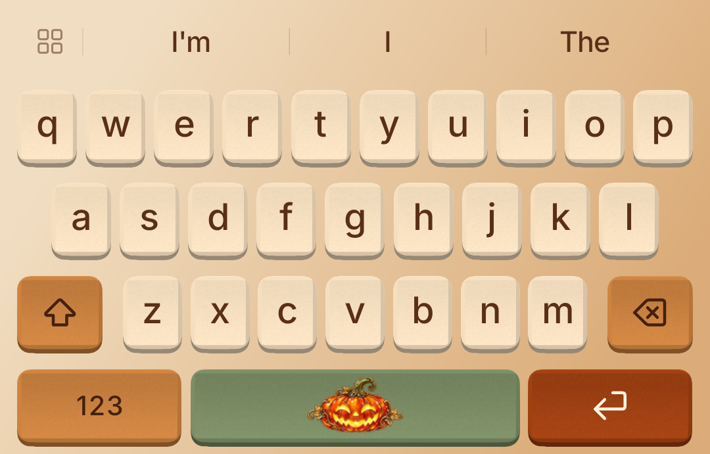</a> | <a href="Themes/halloween-jack-o-lantern.clinktheme"><strong>Jack-o’-Lantern Dark</strong></a> <a href="README-assets/previews/halloween-jack-o-lantern-dark.png">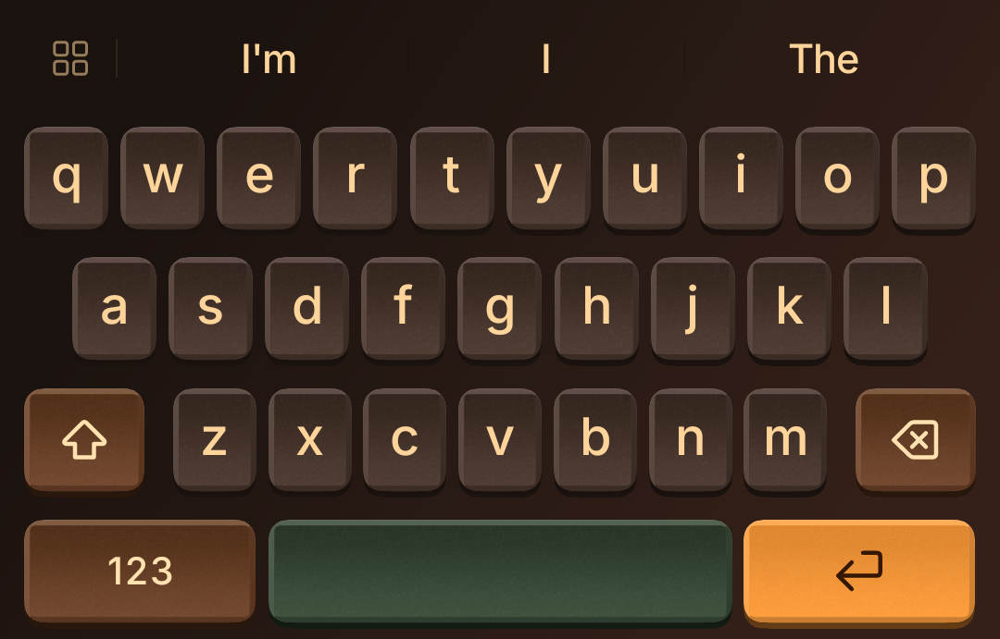</a> |
| <a href="Themes/halloween-witching-hour.clinktheme"><strong>Witching Hour Light</strong></a> <a href="README-assets/previews/halloween-witching-hour-light.png">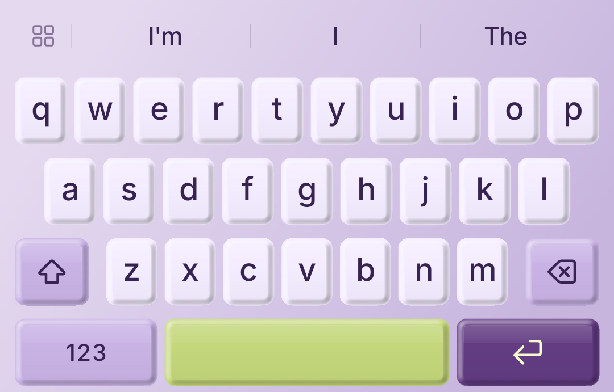</a> | <a href="Themes/halloween-witching-hour.clinktheme"><strong>Witching Hour Dark</strong></a> <a href="README-assets/previews/halloween-witching-hour-dark.png">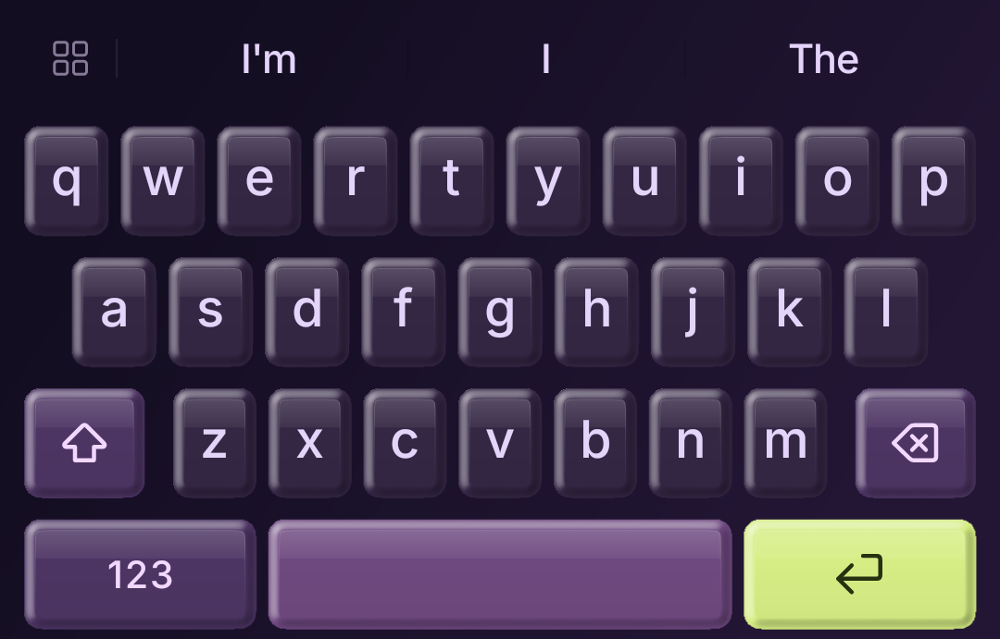</a> |
| <a href="Themes/halloween-ghostlight.clinktheme"><strong>Ghostlight Light</strong></a> <a href="README-assets/previews/halloween-ghostlight-light.png">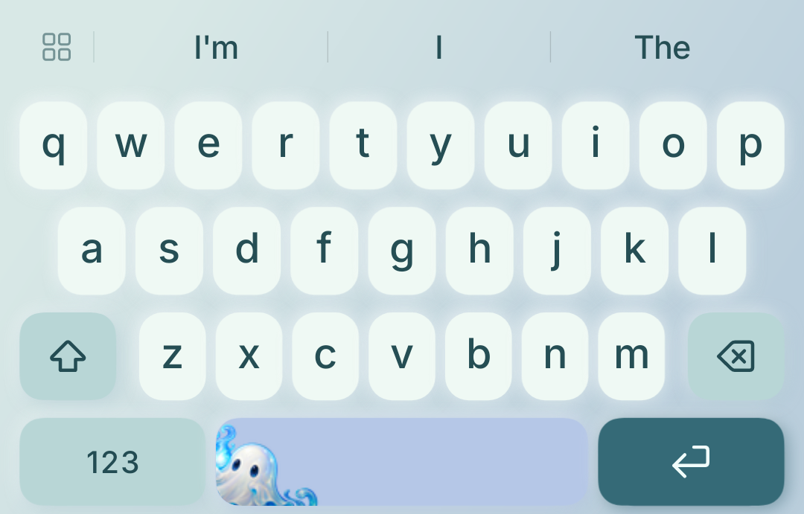</a> | <a href="Themes/halloween-ghostlight.clinktheme"><strong>Ghostlight Dark</strong></a> <a href="README-assets/previews/halloween-ghostlight-dark.png">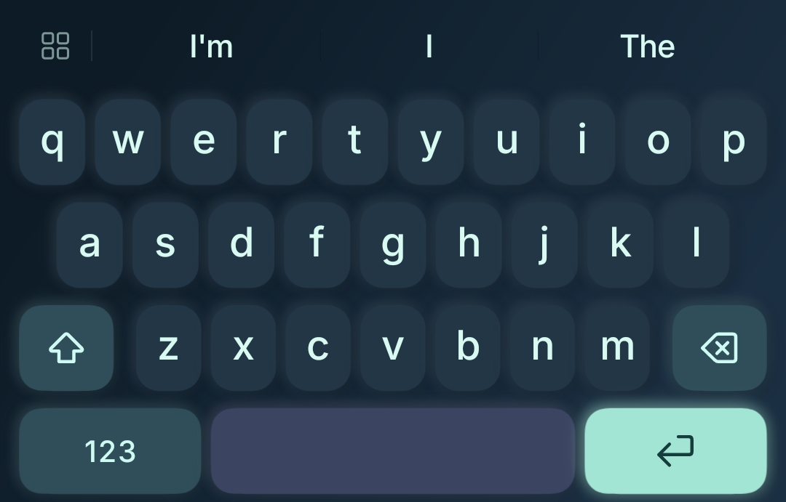</a> |
| <a href="Themes/halloween-vampire-velvet.clinktheme"><strong>Vampire Velvet Light</strong></a> <a href="README-assets/previews/halloween-vampire-velvet-light.png">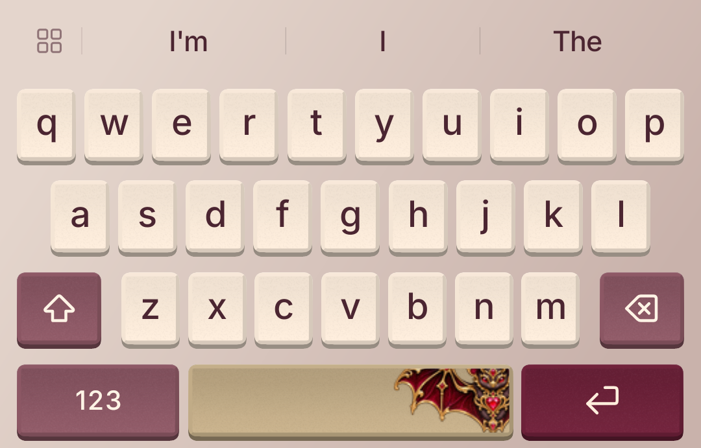</a> | <a href="Themes/halloween-vampire-velvet.clinktheme"><strong>Vampire Velvet Dark</strong></a> <a href="README-assets/previews/halloween-vampire-velvet-dark.png">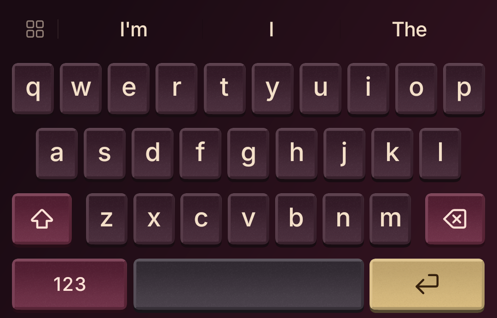</a> |
| <a href="Themes/halloween-candy-coven.clinktheme"><strong>Candy Coven Light</strong></a> <a href="README-assets/previews/halloween-candy-coven-light.png">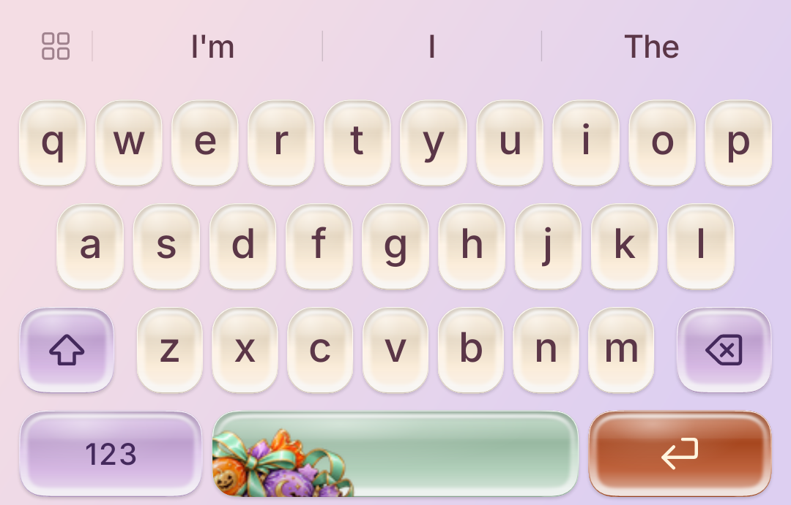</a> | <a href="Themes/halloween-candy-coven.clinktheme"><strong>Candy Coven Dark</strong></a> <a href="README-assets/previews/halloween-candy-coven-dark.png">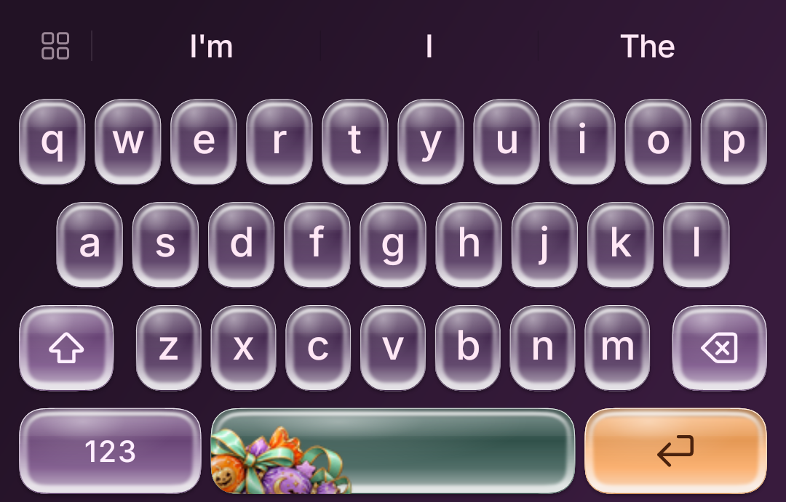</a> |
| <a href="Themes/halloween-haunted-conservatory.clinktheme"><strong>Haunted Conservatory Light</strong></a> <a href="README-assets/previews/halloween-haunted-conservatory-light.png">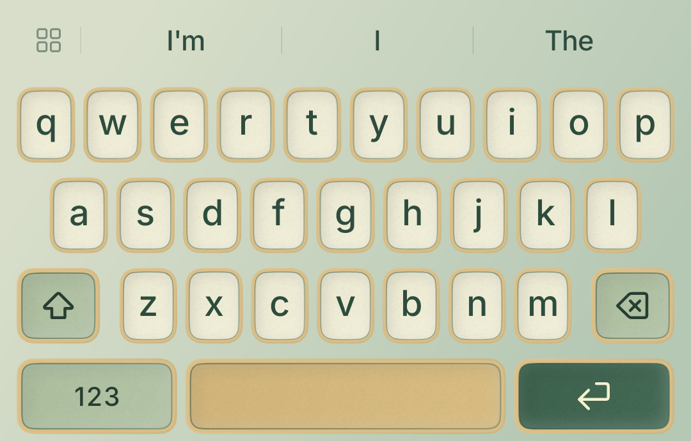</a> | <a href="Themes/halloween-haunted-conservatory.clinktheme"><strong>Haunted Conservatory Dark</strong></a> <a href="README-assets/previews/halloween-haunted-conservatory-dark.png">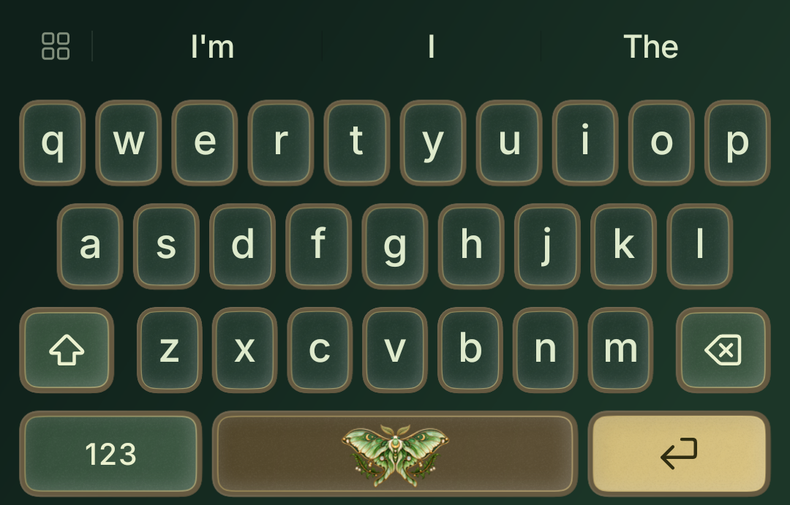</a> |

The collection is available in the [latest release](https://github.com/anti-ltd/clink-themes-events/releases/latest). Each release includes all six paired themes and the verified manifest used by Clink.

Each pair includes an original illustrated spacebar, carried in the theme through Canvas: pumpkin, potion, ghost, jeweled bat, candy and lunar moth. The transparent artwork is in `Artwork/`; `Artwork/generation.json` records the image-generation prompts.

Each illustration has its own oversized, edge-cropped placement in `palettes.json` under `artworkPlacement`. The potion, ghost and moth are angled in the PNG itself, so both platforms and exported themes keep the same composition without needing a separate rotation setting. Preserve natural proportions: intentional clipping at the keycap edges is part of the design, rather than fitting the whole silhouette inside the key.
